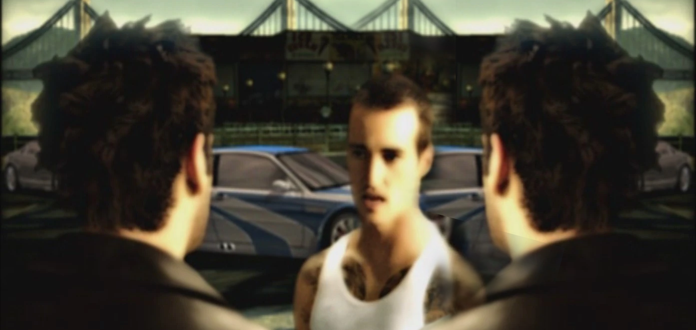

# NFS MW Together: co-op career for Need for Speed: Most Wanted (2005)



**NFS MW Together** (MWT) lets you play the Most Wanted career together. Two players share one world: each drives their own
car with its own tuning, sees the other player's car, traffic and cops, and they start events
together. The host's game is the reference world, and the client mirrors it.

> **Where it's at:** early alpha, two players. Free roam and races already play well together on a LAN.
> The goal is the whole career, start to finish, in co-op. The checklist below shows how far along we are.

## Requirements
- NFS Most Wanted (2005), PC, **v1.3** `speed.exe`. Other versions are detected and the mod
  stays inactive.
- [Ultimate ASI Loader](https://github.com/ThirteenAG/Ultimate-ASI-Loader) (`dinput8.dll`, included in releases).
- Both players need the same NFS MW Together (MWT) version: the protocol version is checked on connect.
- A network path between the PCs: LAN, a VPN such as Radmin VPN or ZeroTier, or UDP port 47555
  forwarded to the host.

This repository contains **only the mod**. It does not include game files or saves. You need your
own copy of the game.

## Install
> **Upgrading from CoopMod?** Delete `scripts\CoopMod.asi`. Your `CoopMod.ini` settings are copied to `MWTogether.ini` on the first start.

1. Download the latest release zip from the **Releases** page.
2. Copy `dinput8.dll` and the `scripts` folder next to `speed.exe`. If you already have an ASI loader,
   keep yours and copy only `scripts\MWTogether.asi` and `scripts\MWTogether.ini`.
3. Edit `scripts\MWTogether.ini`:
   - **Host:** `Mode=host`, `Name=<you>`. `ClientIP=<client IP>` is optional; set it to skip firewall rules on a LAN.
   - **Client:** `Mode=client`, `HostIP=<host IP>`, `Name=<you>`.
4. Start the game on both PCs. The game skips the intro and loads career free roam by itself, and the
   two games connect automatically.

## Features and progress

Ticked means it's in the mod. A **(?)** means it's built but hasn't been properly tested in a real co-op session yet[^1].
Unticked items are still to do.

### Connecting
- [x] Direct connection between two PCs (one hosts, one joins), with ping shown in the overlay
- [x] Clean "bye" when someone quits, Alt+F4 included, and a timeout if a game just disappears
- [x] Stays connected when a game is paused, minimized or alt-tabbed
- [x] Game keeps running in the background when alt-tabbed
- [x] Status overlay on F8, and it remembers whether you hid it
- [x] Launcher (`MWTogetherLauncher.exe` next to `speed.exe`) in the game's style: name, host or join, the host's IP, start options under Settings, then Play
- [x] A short notice in the corner when the other player joins or leaves, even with the overlay hidden
- [x] Those notices in the game's own UI: the EA Trax banner (where songs are announced) shows "<name> joined / left"; the corner line stays as the fallback (`[UI] GameNotices`)
- [x] Joining while the other player is in a race: you roam freely, get a notice, and go together into the next event (?)
- [x] Each side only listens to its partner's address
- [x] Event starts and restarts are repeated for a few seconds, so a lost packet can't leave you in different races (?)
- [ ] Up to 4 players

### Your cars
- [x] Each player drives their own car, with their full tuning, in free roam and in races
- [x] Smooth movement of the other player's car (about 1-10 mm of jitter)
- [x] Spawn protection, so two cars appearing on the same spot don't launch each other
- [x] Other player's blip on the minimap
- [x] Other player on the world map, coloured like your own arrow and moving while the map is open
- [x] Car-to-car collisions between players
- [x] Your names in the race standings instead of the shared save name

### The world
- [x] Shared traffic when you're near each other
- [x] Cops of the other player show up for you, light bars included
- [x] Each player keeps their own heat and pursuit, and sees the cops chasing the other player
- [x] Cops may switch to chasing the other player when you're both being chased (?)
- [x] Cars near the other player keep full physics instead of floating along the road (?)
- [x] Hitting the other player's traffic or cops pushes them on their PC too (?)
- [x] Pause menu and world map don't freeze the world while you're connected
- [x] No speedbreaker in co-op (slow motion can't work for two people)

### Events and races
- [x] Starting an event takes the other player into it too
- [x] Both games build the same AI opponents (car models and tuning)
- [x] Opponents on the client follow the host's opponents, so the race looks the same on both screens
- [x] Opponent names match on both PCs
- [x] Race positions use each player's real progress
- [x] Restarting a race restarts it for both of you
- [x] Race intro cutscenes play normally for both
- [x] A win by either player counts for both: cash, unlocks and career progress in each player's own career (`SharedWins`)
- [x] The other player's finish is shown in your standings
- [ ] Blacklist rival races and their rewards (cars, markers): they start together and use shared wins, but nobody has played one in co-op yet
- [ ] Milestones, speed traps and bounty count for each player's own career as in single player; not checked in co-op yet
- [x] Challenge Series events are announced to the other player too. From the menu they get the event's preset car; from free roam they join in their own car (?)

### Career
- [x] Each player keeps their own career; wins are shared, so both careers move forward together
- [x] The host keeps a copy of the other player's career save, updated after every autosave. If that player's own save is missing or older when they connect, it's restored from the host (their old file is kept as a backup)
- [x] Cutscene skip voting: a cutscene you both watch is skipped only when both press skip
- [ ] Story cutscenes outside events started for both players at the same time
- [x] Getting busted or escaping only affects the player being chased; the other one keeps playing

### Quality of life (settings in `[Start]` and `[UI]`)
- [x] Skip the intro logos and movie and load straight into career free roam after the profile (`SkipIntro`, `DirectFreeRoam`)
- [x] The "load complete" screen after the title confirms itself (`SkipLoadComplete`, on by default)
- [x] No "leave the safe house?" question (`SkipLeaveSafeHouseDialog`)
- [x] Menus react while their opening animation plays, and animate 2x faster (`IntroInput`, `MenuSpeed`)
- [x] Optional: close the pursuit result screens in free roam by itself ("Bounty achieved" and the pursuit summary), off by default (`SkipPursuitResults`). Getting busted still shows the fine screen

### Test tools (`[Debug] TestKeys=1`)
- [x] **F5** autopilot: the game's AI drives your car, cruising in free roam and following the route in races. `AutoPilot=1` turns it on by itself
- [x] Autopilot uses nitrous on straights (`[Debug] AutoPilotNos`, default on)
- [x] `[Window] StartInBackground=1`: the game starts without taking the focus, loads the profile and goes into free roam in the background, and stays muted until you click it
- [x] Performance diagnostics: `[Debug] Perf=1` logs fps, 1% lows, worst frame and how many milliseconds each part of the mod takes, every 5 seconds (it's also shown in the F8 overlay)
- [x] **F7** starts the test event (`TestEvent`) for both players
- [x] **F10 / F11** spawn or remove a test copy of the other player's car, **F12** spawns a test cop
- [x] Test commands in `scripts\MWTogether.cmd` also include `pursuit` (the cops start a pursuit on you) and `uncop` (remove every police car, so the pursuit ends in an escape)

[^1]: (?) means we wrote it and it ran without errors, but nobody has played through it properly on two PCs yet,
    so it may still misbehave. If you try one of these, tell us how it went.
## Configuration
Every option is in `scripts\MWTogether.ini`, which comments each one. Main sections:
`[Network]`, `[Player]`, `[Ghost]`, `[Traffic]`, `[Coop]`, `[Start]`, `[AutoStart]`, `[UI]`, `[Window]`, `[Debug]`.

## Build from source
- Visual Studio 2022 with the C++ workload (MSVC x86).
- Run `build.bat`. It produces `build\MWTogether.asi`. When this folder sits inside the game folder
  (`<game>\MWTogether-src\`), the script also installs the plugin into `<game>\scripts\`.
- Nothing builds automatically on GitHub. The **Build** workflow under **Actions** runs only when you start it
  by hand: it builds the plugin and the launcher, runs the tests and packages the zip with the ASI loader. Give
  it a version number and it also creates the GitHub release.
- Local release, without Actions: `tools\release.ps1 -Version 0.2.0` publishes a pre-release; add `-Final` for a
  normal release. `-DryRun` only builds the zip in `dist\`.

## Testing
The network code, the config reader and the maths behind the remote cars have tests that run without the game:

```
tests\build_tests.bat
```

It builds `build\tests.exe` and runs it, then runs the same tests again under AddressSanitizer when your
MSVC supports it. About 80 tests: packet layouts and protocol version, connecting / leaving / timeouts,
snapshot interpolation and extrapolation, clock sync, traffic / event / roster / restart packets, `MWTogether.ini`
parsing, and fuzz tests that throw several hundred thousand random and damaged datagrams at the packet
handler to make sure nothing a network can deliver crashes the game. Exit code 0 means everything passed.

What the tests can't cover is everything inside the game itself (spawning cars, races, cops): that still needs
two PCs. See [CONTRIBUTING.md](CONTRIBUTING.md) for the details and for adding tests.

## How it works (short)
`MWTogether.asi` is loaded by the ASI loader inside `speed.exe`. It hooks Direct3D 9 `Present` to run once per
frame on the game thread, and it patches game code and vtables at known v1.3 addresses, found by reverse
engineering. Remote cars are real game vehicles (`PVehicle`) whose rigid bodies are set every frame from
interpolated network snapshots. Race opponents and traffic of the other PC are "mirrors" driven the same way.
The code is in `src/`:

| File | What |
|---|---|
| `main.cpp` | frame loop, hotkeys, overlay text, start-up patches |
| `net.*` | UDP protocol (hello, state, car info, traffic, events, roster, restart, keep-alive) |
| `netutil.h` | pure helpers: interpolation maths, traffic ids, name limits, validation of received numbers |
| `game.cpp` | vehicles, spawning, the other player's car (ghost), race integration, autopilot |
| `traffic.inl` | traffic, cop and race-opponent mirroring |
| `event.inl` | shared event start, roster, co-op rules (speedbreaker, no pause, restart sync) |
| `pursuit.inl` | cops chasing the other player |
| `stream.inl` | world streaming around the other player |
| `minimap.inl`, `worldmap.inl` | player blips |
| `boot.inl` | fast start (skip intro, direct free roam, no safe-house dialog) |
| `input.*` | DirectInput observation, menu automation (AutoStart) |
| `overlay.*` | D3D9 hooks and the status overlay |

## Contributing
Contributions are welcome. See [CONTRIBUTING.md](CONTRIBUTING.md).

## Credits
- Reverse-engineering references: NFSPluginSDK (MW05 headers), MostWantedTimeTrialGhosts and
  nya-common-nfsmw (MPL-2.0), ExOpts.
- [Ultimate ASI Loader](https://github.com/ThirteenAG/Ultimate-ASI-Loader) by ThirteenAG.
- Need for Speed and Most Wanted are trademarks of Electronic Arts. This is an unofficial fan project, not affiliated with EA.
