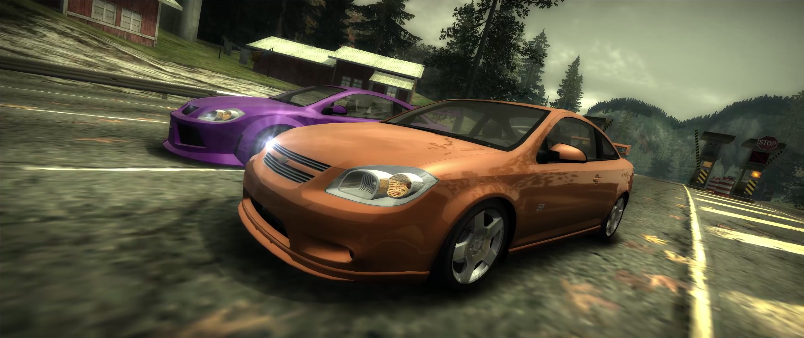
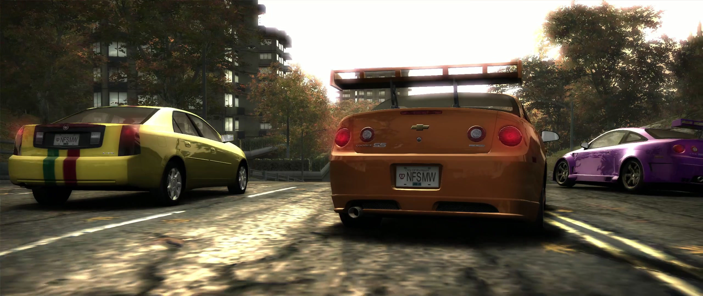
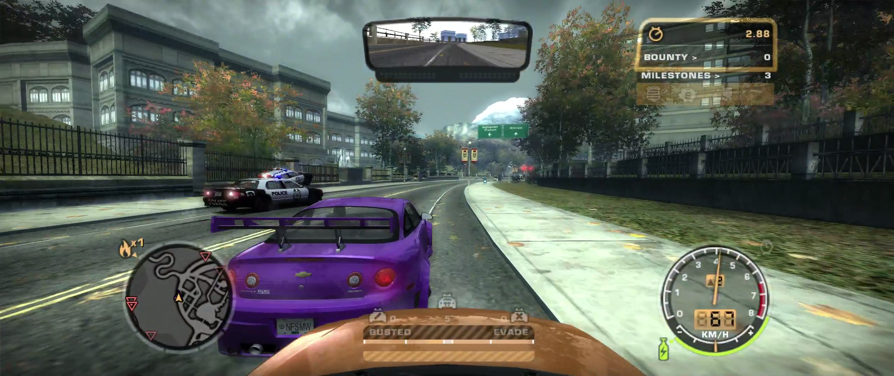
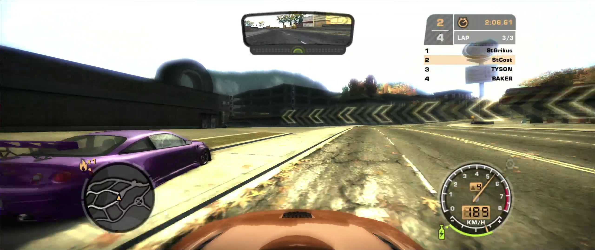

# NFS MW Together: co-op career for Need for Speed: Most Wanted (2005)


Play the Most Wanted career with a friend. 2 players, LAN or VPN.

A **co-op mod for Need for Speed: Most Wanted 2005** (PC, v1.3). Two players go through the
**career together**: free roam with traffic, races against the AI, the Blacklist, police chases,
each in their own car. Works over LAN or a VPN (Hamachi, Radmin VPN, ZeroTier).

**Get it:** [GitHub releases](https://github.com/StCost/nfs-most-wanted-together/releases/latest) · [Nexus Mods](https://www.nexusmods.com/needforspeedmostwanted2005/mods/366) · [NFSMods](https://nfsmods.xyz/mod/8207)

**Tested by the developers:** the co-op career up to the 13th Blacklist rival. More playtesting soon.

| | |
|---|---|
|  |  |
|  |  |

*A.K.A.: NFS MW co-op, NFSMW multiplayer career, Most Wanted 2005 coop campaign, NFS Most
Wanted online free roam with a friend, Need for Speed Most Wanted two player mod.*

<details open><summary><h2>Install</h2></summary>


1. Download **[MWTogether.zip](https://github.com/StCost/nfs-most-wanted-together/releases/latest/download/MWTogether.zip)** (the latest release) and unpack it into your game folder, next to `speed.exe`.
2. Run `MWTogetherLauncher.exe`. Type a nickname, pick **Host LAN** or **Join LAN** (to join, enter the
   host's IP address) and press **PLAY**.
3. Do the same on the other PC. The game loads your career into free roam and connects you on its own.
4. To update, unpack the new zip over the old one. Your nickname and settings (`scripts\MWTogether.ini`) stay.

You can play the prologue (the opening BMW races) together too: start a new career on both PCs. Whoever is ahead waits on the next race's grid (`[Coop] Prologue`). After the car lot you both drive to Mia, and co-op picks up again once you've both met her. You both need to be in the same part of the career: both in the prologue, or both past it.


</details>

<details open><summary><h2>You need</h2></summary>


- Need for Speed: Most Wanted (2005) for PC, patched to **v1.3**. No game files are included, bring your own copy.
- The same version of the mod on both PCs.
- A LAN, a VPN (Hamachi, Radmin VPN, ZeroTier), or UDP port 47555 forwarded to the host.
- If one of you can't see the other, a firewall or another VPN (Surfshark, say) is blocking it. Allow UDP 47555 for `speed.exe` on that PC or pause the VPN. The game tells you when only one side gets through.


</details>

<details open><summary><h2>What to expect</h2></summary>


- **Your own cars.** You both drive your own car with your tuning and visuals, damage and brake lights included.
- **Events together.** Start any career event and your partner comes along: same opponents, same start, and you see each other.
- **Shared wins.** If one of you wins, you both win. Whoever is still driving gets finished as the winner right there.
- **Police.** In free roam you share the cops: same heat, you lose them together, you get busted together. Your partner's cops show on your minimap and set off your radar.
- **One world.** Shared traffic when you're close, collisions between your cars, blips on the minimap and the map.
- **Saves.** Each of you keeps your own career save. The host also keeps a backup of the partner's save and gives it back if theirs goes missing. It never overwrites a save that exists, so your settings stay yours.


</details>

<details><summary><h2>Features and progress (100%)</h2></summary>

<details><summary><b>Connecting</b></summary>

- [x] Direct connection between two PCs (one hosts, one joins), ping in the overlay
- [x] Quitting (Alt+F4 too) tells the other side right away; a game that just disappears times out
- [x] Stays connected while paused, minimized or alt-tabbed, and the game keeps running in the background
- [x] Status overlay on F8 (remembers if you hid it)
- [x] Launcher (`MWTogetherLauncher.exe`, next to `speed.exe`) styled like the game: name, host or join, host IP, settings, Play
- [x] Join / leave notices, even with the overlay hidden
- [x] Notices use the game's own message line in the middle of the screen: joins and leaves in green, problems (connection, firewall, prologue) in orange. Long ones come in parts. In cutscenes and menus the EA Trax song banner shows them
- [x] Notices stay up for 10 seconds (`[UI] NoticeSeconds`)
- [x] Joining while the other player is in a race: you drive around freely and join the next event together
- [x] Only the player you connected to can talk to your game; packets from anyone else are ignored
- [x] Event starts and restarts are sent several times, so one lost packet can't split you into different races


</details>
<details><summary><b>Your cars</b></summary>

- [x] Your own car with your full tuning, in free roam and in races
- [x] The other player's car moves smoothly (1-10 mm of jitter)
- [x] Spawn protection: two cars appearing on the same spot don't launch each other
- [x] The other player on the minimap and on the world map, in a colour they pick (launcher: My colour on the map, `[Player] Color`)
- [x] Car-to-car collisions with real impact: ram your partner and their car gets thrown on their screen too
- [x] Your own names in the race standings
- [x] Your partner's car shows brake lights, damage (dents, broken parts), steering and nitrous


</details>
<details><summary><b>The world</b></summary>

- [x] Shared traffic when you're near each other
- [x] You see the other player's cops (light bars too) and the cops chasing them
- [x] When you're both chased, cops can switch to the other player
- [x] Traffic near the other player keeps full physics
- [x] The other player's traffic, cops and opponents stay on the road on your screen, even where their game has no road loaded under them
- [x] Semi trucks keep their trailers
- [x] Hitting the other player's traffic, cops or opponents pushes the real car on their PC
- [x] The pause menu and world map don't stop time while you're connected
- [x] No speedbreaker in co-op (slow motion can't work for two). The short slow-motion shots (speed traps, finish line, crash cams) play like in the normal game (`[Coop] NoSlowMotion=1` turns them off)
- [x] Smooth traffic handover: drive away from the other player and their traffic around you keeps going as your own. Come back, and their cars only show up where you can't see them appear, or quietly replace one of yours (`[Traffic] SmoothHandover`)
- [x] Shared traffic in races: the client shows the host's traffic with its own cars, so the race scripts keep working. Same positions on both screens, though the model can differ (`[Traffic] SharedInRaces`)
- [x] No cars popping up in front of you: new traffic and cops never appear within ~60 m in front of either player (`[Traffic] NoSpawnNearPlayers`)
- [x] Same weather on both PCs: the client gets the host's rain and wet roads (`[Coop] SyncWeather`)


</details>
<details><summary><b>Events and races</b></summary>

- [x] Starting an event takes the other player along, even from the results screen of the last race
- [x] Same AI opponents on both PCs (cars, tuning, names), and on the client they follow the host's, so the race looks the same on both screens
- [x] Race positions use each player's real progress and update the moment one passes the other
- [x] Joining from far away still gives the other player a spot in the standings (in an AI car's body if their car isn't loaded on your PC yet)
- [x] Separate grid slots, and you see each other from the countdown on (`SeparateGridSlots`)
- [x] Whoever loads first waits on the grid for the other (`StartTogether`)
- [x] Restart restarts the race for both of you, from the results screen too
- [x] AI catch-up (rubber banding) follows whoever of you is ahead, Blacklist rivals included (`CatchUpLeader`)
- [x] Race intro cutscenes play for both
- [x] A win by either of you counts for both: cash, unlocks and progress in each own career. The one still driving is finished as the winner on the spot, with the winner's screen, the payout and the rival's progress (`SharedWins`)
- [x] You see the other player's finish in your standings
- [x] Blacklist rival races: you both race the rival, the client's rival follows the host's (second race of the series too), and you each get the normal rival flow after winning
- [x] In rival races your partner has their own racer slot: a grid slot and a row in the standings (`[Coop] PartnerInRivalRaces`)
- [x] Rival races also get one extra AI racer on the rival's side, with normal AI and catch-up. It drives the car the race intro shows (Ming, #10, Big Lou) when there is one (`[Coop] BossHelper`)
- [x] Rival races and story events (Razor's races, the final pursuit) only take along a partner who's at the same Blacklist rival, so nobody skips ahead. Continue on "race the rival" takes your partner to the next race too
- [x] The final pursuit loads in about a second
- [x] The prologue together: start a new career on both PCs. Each game plays its own prologue, and whoever is ahead waits on the next grid. Your partner races next to you, and the Razor race is still lost for both (`[Coop] Prologue`)
- [x] After beating a rival, each of you picks your own markers and gets your own rewards (pink slip, cash, parts)
- [x] Bounty goes to each player's own career
- [x] Shared milestones and speed traps: when one of you completes one for your current rival, the other gets it too, with the bounty, if they're at the same rival (`[Career] SharedMilestones`)
- [x] Challenge Series: start from the main menu on both PCs and you both load the event with its car. Someone roaming in career isn't pulled in


</details>
<details><summary><b>Career</b></summary>

- [x] Each of you keeps your own career; wins are shared, so both move forward together
- [x] The host keeps a copy of the partner's save, updated on every autosave, and restores it if theirs is missing. It never replaces a save that exists (`[Career] RestoreOnlyMissing`)
- [x] A cutscene you both watch is skipped only when both of you press skip
- [x] Story movies and cutscenes outside events: the other player gets a notice and waits in free roam until it's done (`SyncStoryScenes`). The next Blacklist rival's intro and the marker picks after beating a rival are each player's own: nobody waits for them. With `SyncStoryScenes=2` the movie plays on their PC too if their career is that far
- [x] Shared pursuits (`[Coop] SharedPursuits`): you get the same heat, the higher one counts
- [x] The other player's cops show on your minimap and trigger your radar
- [x] Ramming their cop starts a pursuit on you
- [x] Blacklist pursuits (milestones, bounty) started from the Blacklist screen take your partner along to the start (`[Coop] FollowToPursuits`)
- [x] One of you gets busted, you both get busted
- [x] Escaping: the cooldown only runs while neither of you is seen, restarts when either one is spotted, and you both escape at the same moment
- [x] No pursuit-start camera: the camera stays on your car when a chase starts (`NoPursuitCams`)
- [x] `SharedPursuits=0`: busted and escape only affect the player being chased


</details>
<details><summary><b>Quality of life (settings in <code>[Start]</code>, <code>[UI]</code> and <code>[Input]</code>)</b></summary>

- [x] Goes straight into career free roam after the profile loads (`DirectFreeRoam`); can skip the intro logos and movie (`SkipIntro`, off by default)
- [x] Several profiles: the quick start loads the one you used last (`[Start] LastProfile`); the first time you pick it yourself
- [x] **F1** hides the minimap, heat meter and speedometer, keeping the rear-view mirror. F1 again brings them back (`[UI] HideHudKey`)
- [x] Confirms the "load complete" screen for you (`SkipLoadComplete`)
- [x] No "leave the safe house?" question (`SkipLeaveSafeHouseDialog`)
- [x] Menus react during their opening animation and animate twice as fast (`IntroInput`, `MenuSpeed`)
- [x] Can close the pursuit result screens in free roam for you, off by default (`SkipPursuitResults`). The busted fine screen still shows
- [x] Pads and wheels plugged in mid-game (USB or Bluetooth) work right away, reconnects too, and keep your bindings (`[Input] GamepadHotplug`)
- [x] Your pad keeps its bindings even when the game starts without it (`[Input] KeepPadBindings`)


</details>
<details><summary><b>Test tools (<code>[Debug] TestKeys=1</code>)</b></summary>

- [x] **F5** autopilot: the game's AI drives your car around free roam or along the race route, using nitrous on straights (`AutoPilot`, `AutoPilotNos`)
- [x] `[Window] StartInBackground=1`: the game starts without stealing focus, goes into free roam in the background and stays muted until you click it
- [x] Car budget log: the game fits 20 cars in the world (both players, traffic, cops). The log says which cars got removed or refused to make room, plus a summary every 30 s
- [x] `[Debug] Perf=1` logs fps, 1% lows, the worst frame and the mod's own cost every 5 seconds (also in the F8 overlay)
- [x] **F7** starts the test event (`TestEvent`) for both players
- [x] **F10 / F11** spawn or remove a copy of the other player's car, **F12** spawns a cop
- [x] Test commands in `scripts\MWTogether.cmd`, like `pursuit`, `uncop`, `ram cop` and `tp x y z`. Full list in `docs/TESTING.md`


</details>


</details>

<details><summary><h2>Configuration</h2></summary>

All options are in `scripts\MWTogether.ini`, with a comment on each. Sections:
`[Network]`, `[Player]`, `[Ghost]`, `[Traffic]`, `[Coop]`, `[Start]`, `[AutoStart]`, `[UI]`, `[Window]`, `[Debug]`.


</details>

<details><summary><h2>Build from source</h2></summary>

- Visual Studio 2022 with the C++ workload (MSVC x86).
- Run `build.bat`. It produces `build\MWTogether.asi`. When this folder sits inside the game folder
  (`<game>\MWTogether-src\`), the script also installs the plugin into `<game>\scripts\`.
  That is a dev build with the test keys and commands (`docs/TESTING.md`); `set MWT_RELEASE=1` first for a
  release build without them (`tools\release.ps1` and the workflow do this).
- Nothing builds automatically on GitHub. The **Build** workflow under **Actions** runs only when you start it
  by hand: it builds the plugin and the launcher, runs the tests and packages the zip with the ASI loader. Give
  it a version number and it also creates the GitHub release.
- Local release, without Actions: `tools\release.ps1 -Version 0.2.0` publishes a pre-release; add `-Final` for a
  normal release. `-DryRun` only builds the zip in `dist\`.
- The launcher is built by `tools\build-launcher.ps1`. Its pictures are files in `scripts\launcher\`, not part of the
  exe. Every release lists the SHA256 of its files, and files built by the workflow carry a build provenance
  attestation: `gh attestation verify MWTogether.zip --repo StCost/nfs-most-wanted-together`.


</details>

<details><summary><h2>Testing</h2></summary>

The network code, the config reader and the remote-car maths have tests that run without the game:

```
tests\build_tests.bat
```

It builds `build\tests.exe` and runs it, then runs the same tests again under AddressSanitizer when your
MSVC supports it. Tests include: packet layouts and protocol version, connecting / leaving / timeouts,
snapshot interpolation and extrapolation, clock sync, traffic / event / roster / restart packets, `MWTogether.ini`
parsing, and fuzz tests that throw several hundred thousand random and damaged datagrams at the packet
handler to make sure nothing a network can deliver crashes the game. Exit code 0 means everything passed.

Everything that needs the game - the test commands, the two-PC scenarios (`tools\coop-test.ps1`) and what a pass looks like - is in [docs/TESTING.md](docs/TESTING.md).

What the tests can't cover is everything inside the game itself (spawning cars, races, cops): that still needs
two PCs. See [CONTRIBUTING.md](CONTRIBUTING.md) for the details and for adding tests.


</details>

<details><summary><h2>How it works (short)</h2></summary>

`MWTogether.asi` is loaded by the ASI loader inside `speed.exe`. It hooks Direct3D 9 `Present` to run once per
frame on the game thread, and it patches game code and vtables at known v1.3 addresses, found by reverse
engineering. Remote cars are real game vehicles (`PVehicle`) whose rigid bodies are set every frame from
interpolated network snapshots. Race opponents and traffic of the other PC are "mirrors" driven the same way.
The code is in `src/`:

| File | What |
|---|---|
| `main.cpp` | frame loop, hotkeys, overlay text, start-up patches |
| `net.*` | UDP protocol (hello, state, car info, traffic, truck trailers, events, roster, restart, keep-alive) |
| `netutil.h` | pure helpers: interpolation maths, traffic ids, race traffic binding, traffic handover rules (camera view, when a car may appear or go), name limits, validation of received numbers |
| `game.cpp` | vehicles, spawning, the other player's car (ghost), race integration, autopilot |
| `traffic.inl` | traffic, cop and race-opponent mirroring |
| `budget.inl` | the game's 20-car budget, logged |
| `event.inl` | shared event start, roster, co-op rules (speedbreaker, no pause, restart sync) |
| `coopwin.inl` | shared wins |
| `bosshelper.inl` | rival races together: the partner's racer slot and the extra AI racer |
| `pursuit.inl` | cops chasing the other player, shared heat / busted / cooldown, their cops on the minimap and radar, no pursuit-start camera |
| `follow.inl` | going along to a Blacklist pursuit |
| `milestone.inl` | shared milestones and speed traps |
| `nis.inl`, `story.inl` | cutscene skip voting, story movies and scenes |
| `save.inl` | the host's copy of the partner's career save |
| `weather.inl` | the same rain on both PCs |
| `stream.inl` | world streaming around the other player |
| `minimap.inl`, `worldmap.inl` | player blips |
| `hud.inl` | F1: hide the minimap and the gauges |
| `boot.inl` | fast start (skip intro, direct free roam, no safe-house dialog, last profile), final pursuit load fix |
| `input.*`, `pad.cpp` | DirectInput, menu automation (AutoStart), gamepad hot-plug and bindings |
| `overlay.*` | D3D9 hooks and the status overlay |
| `*util.h` | the rules that don't need the game (pursuit, race, ground, milestones, prologue, profiles, notices, saves), covered by `tests\` |


</details>

<details><summary><h2>Contributing</h2></summary>

Pull requests welcome, see [CONTRIBUTING.md](CONTRIBUTING.md).


</details>

<details><summary><h2>License</h2></summary>

MIT - see [LICENSE](LICENSE). The bundled Ultimate ASI Loader (`dinput8.dll`) is MIT too: [THIRD-PARTY-NOTICES.txt](THIRD-PARTY-NOTICES.txt).


</details>

<details><summary><h2>Credits</h2></summary>

- Reverse-engineering references: NFSPluginSDK (MW05 headers), MostWantedTimeTrialGhosts and
  nya-common-nfsmw (MPL-2.0), ExOpts.
- [Ultimate ASI Loader](https://github.com/ThirteenAG/Ultimate-ASI-Loader) by ThirteenAG.
- Need for Speed and Most Wanted are trademarks of Electronic Arts. This is an unofficial fan project, not affiliated with EA.


</details>
